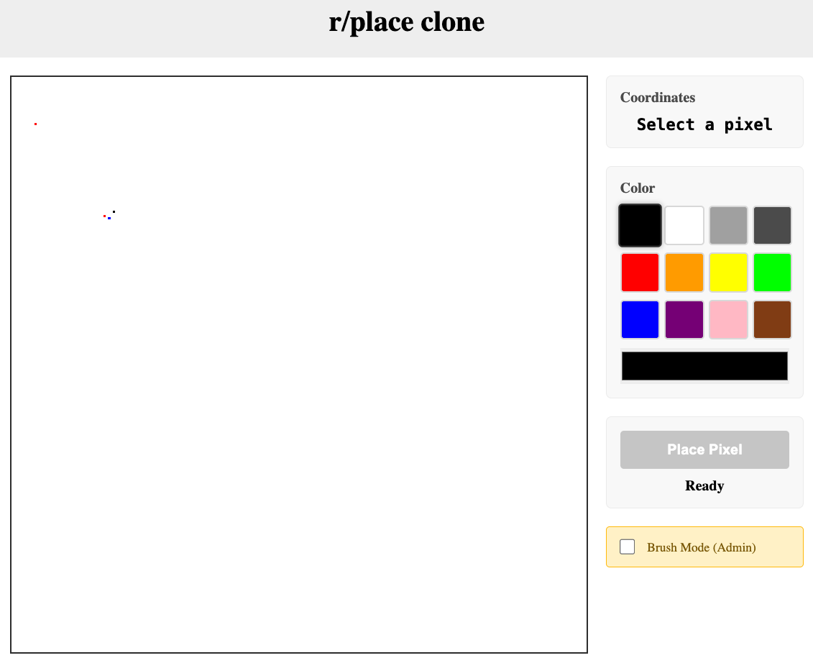
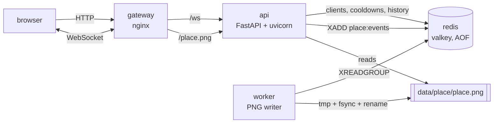
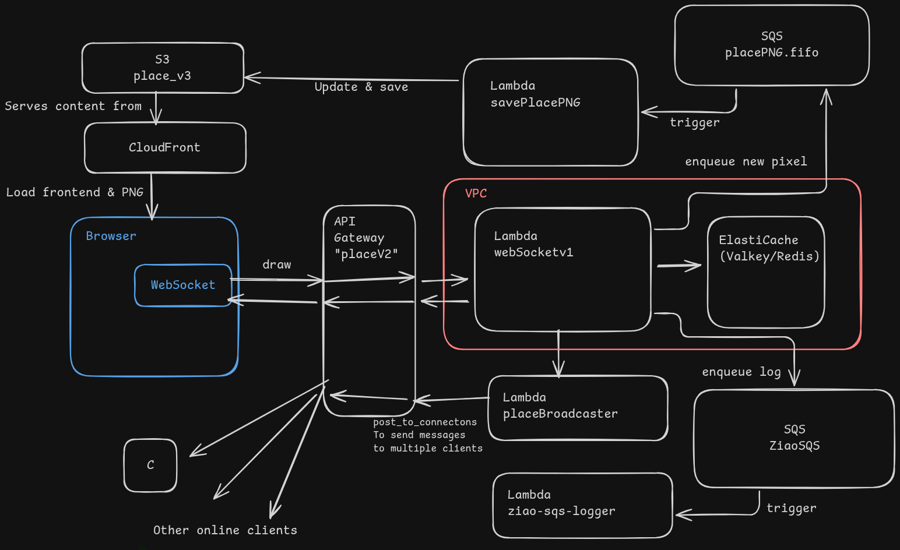

# place

A collaborative 250×250 pixel canvas — an r/place clone — that originally ran on AWS
serverless (API Gateway WebSocket, four Lambdas, ElastiCache, SQS, S3, CloudFront) and now
runs as a four-container Docker Compose stack on a single small server.

Live demo: <https://place.jessexu.me>



## What it is

You click a pixel, choose a colour, and hit **Place Pixel**. Everyone else connected to the
page sees it immediately. New visitors get the current drawing as a PNG, so the canvas
survives restarts and reloads. There is a 5 second per-browser cooldown, a 12-colour
palette plus a custom colour picker, and a brush mode for admins.

## Run it

```bash
cp .env.example .env         # then set PLACE_DATA_DIR to an absolute path
docker compose up -d
```

Open <http://localhost:8090>. One port serves the frontend, the WebSocket and the canvas
image; everything stateful lives on the host filesystem under `$PLACE_DATA_DIR`.

| variable | default | meaning |
|---|---|---|
| `PLACE_PORT` | `8090` | the single published host port |
| `PLACE_BIND` | `0.0.0.0` | bind address; use `127.0.0.1` behind a reverse proxy |
| `PLACE_DATA_DIR` | `./data` | host directory for `redis/` and `place/` |
| `PLACE_UID` / `PLACE_GID` | `1000` | owner of the files written into `PLACE_DATA_DIR` (must match the host user, see `id -u`) |
| `IMAGE_SIZE` | `250` | canvas edge in pixels |
| `RATE_LIMIT_SECONDS` | `5` | per-browser cooldown |
| `ADMIN_CLIENT_IDS` | empty | comma-separated browser ids that bypass the cooldown |

## Architecture



| service | role | state it owns |
|---|---|---|
| `gateway` | nginx: static frontend, `/ws` upgrade, `/place.png` proxy | none (config + static mounted read-only) |
| `api` | FastAPI: the whole WebSocket protocol, rate limiting, history | Redis keys, the `place:events` stream |
| `worker` | consumes the stream, applies pixels, writes the PNG | `data/place/place.png`, consumer group |
| `redis` | Valkey with AOF on a bind mount | `data/redis/` |

## How it got here

```
v1   two Node services in Docker on one EC2 instance
v2   Lambda + managed Redis, hosted frontend, API Gateway WebSocket
v3   API Gateway + four Lambdas + ElastiCache + SQS + S3/CloudFront
v4   this: the same design in four containers on a pre-owned VPS
```

To save AWS costs, we migrated from v3 to this architecture on a pre-owned VPS. The core
design and logic are preserved. The project has now moved twice across the hosting boundary:
from a small self-managed Docker deployment, onto the cloud with serverless services, and
back to a conventional container-based architecture. Each earlier version added one idea the
current stack still relies on — a separate socket server, state that outlives the process,
then queues and a durable image.

The three earlier versions are kept in [`legacy/`](legacy/), with their original design notes
and architecture diagrams.

## The original AWS version (v3)

Version 3 was a fully serverless deployment.
Browsers loaded the frontend and the current canvas PNG from CloudFront/S3 and held a
WebSocket to API Gateway. Each frame became a Lambda invocation; the handler ran inside a
VPC against ElastiCache for connections and history, and pushed work onto two SQS queues —
one to a broadcaster Lambda that called `post_to_connection` for every live client, one to a
PNG-writing Lambda that kept `place.png` in S3.



Services used: S3 + CloudFront (static files and the canvas PNG), API Gateway WebSocket API
(routes `$connect`, `$disconnect`, `draw`, `getHistory`, `checkRateLimit`), four Lambdas
(`webSocketV1`, `placeBroadcaster`, `savePlacePNG`, `ziao-sqs-logger`), ElastiCache Valkey,
two SQS queues, a VPC with interface endpoints, IAM roles and CloudWatch logs.

It was retired when the cost stopped making sense: API Gateway, ElastiCache and a NAT gateway
bill by the hour whether or not anyone is drawing, and the trial credits had expired. The
current version keeps the data model, the Redis key names and the wire protocol, and replaces
each managed service with a container.

## How the AWS design maps onto containers

| AWS (v3) | here | why it is equivalent |
|---|---|---|
| S3 static + CloudFront | `gateway` (nginx with a static dir) | one origin serves HTML, JS and the PNG |
| API Gateway WebSocket + routes | one `/ws` endpoint dispatching on the frame's `action` | same routing key (`$request.body.action`), same frames |
| `$connect` / `$disconnect` routes | on-accept / on-disconnect handlers | connection registry in Redis |
| Lambda `webSocketV1` | `api/place/app.py` | same handlers, same Redis keys, same cooldown maths |
| Lambda `placeBroadcaster` + `post_to_connection` | `api/place/hub.py` | in-process fan-out over live sockets |
| Lambda `savePlacePNG` + SQS `placePNG.fifo` | `worker` + Redis Stream consumer group | ordered, at-least-once, replayable |
| ElastiCache Valkey | `redis` (valkey image, AOF) | same commands, same key names |
| S3 `place.png` | `data/place/place.png` | durable "current image", written tmp+fsync+rename |
| Lambda `ziao-sqs-logger` + CloudWatch | stdout logs (`docker compose logs api`) | one log sink, no queue needed |
| VPC / NAT gateway / endpoints | the compose bridge network | isolation only, none of the cost |

The wire protocol is byte-identical to v3, so the frontend diff is tiny: the socket URL
became same-origin `/ws`, plus reconnect and a re-fetch of the PNG after a drop.

## Why these choices

- **One API process.** Connection state and fan-out live in a `Hub` dict, exactly like the
  Lambda did with API Gateway's connection registry. Two API replicas would each broadcast
  to their own clients only; scaling out would need Redis pub/sub. One process is enough for
  this workload and is honest about the trade-off.
- **Redis Streams instead of SQS.** `XADD` / `XREADGROUP` / `XACK` gives an ordered,
  at-least-once queue with a replayable consumer group, in the datastore that is already
  there. No broker container, no LocalStack.
- **The PNG is the durable canvas.** Clients load it on connect, so there is no history
  replay path to keep correct. The worker debounces writes to 4 per second and flushes on
  SIGTERM, so `docker compose restart` loses nothing.
- **nginx as the only ingress.** One published port carries both HTTP and the WebSocket
  upgrade, so a TLS terminator or CDN can sit in front without touching the app. The
  upstream is resolved at request time, so rebuilding `api` does not leave a stale IP.

## Repo map

```
api/            FastAPI app, the PNG worker, tests, smoke client
  place/        config, pixels, rate_limit, png_store, store, hub, app, worker
  tests/        37 tests (36 unit + 1 Redis integration)
gateway/        nginx.conf + the v3 frontend, patched to same-origin
docs/           architecture, deployment runbook, screenshot
legacy/         v1, v2 and v3 sources with their notes and diagrams
docker-compose.yml
```

`legacy/` keeps the three earlier versions for reference. The revival reuses their names,
key names and logic deliberately, so the AWS lambdas and `api/place/` can be read side by
side.

## Tests

```bash
docker compose run --rm --no-deps -v "$PWD/api:/app" -w /app api pytest -q
# 36 passed, 1 skipped
docker compose run --rm -e REDIS_URL_TEST=redis://redis:6379/0 \
  -v "$PWD/api:/app" -w /app api pytest -q
# 37 passed
```

The suite needs no Redis: `MemoryStore` implements the same protocol as `RedisStore`, and
one `@pytest.mark.integration` test exercises the real adapter.

## Deploying

See [docs/deploy.md](docs/deploy.md).
